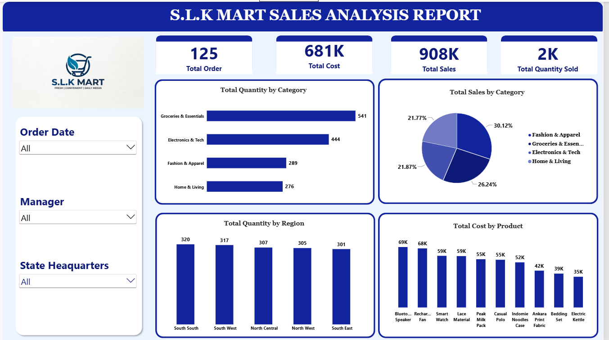

# S.L.K Mart: Retail Sales & Regional Performance Analytics

## 1. Project Title and Introduction
The **S.L.K Mart Sales Analysis Report** is an end-to-end business intelligence solution developed to evaluate retail sales performance, operational costs, category demand, and regional fulfillment across S.L.K Mart's operational footprint. 

This project transforms raw transactional records into an interactive Power BI dashboard, enabling retail leadership and regional managers to track key performance indicators (KPIs), identify top-performing product categories, and analyze cost structures across multiple regional headquarters.

---

## 2. Business Problem
Retail enterprises often struggle to maintain unified visibility over multi-regional sales operations, inventory turnover costs, and product category profitability. Leadership at S.L.K Mart required a centralized reporting tool to answer critical operational questions:
* What are the total revenue generation and underlying cost footprints across retail categories?
* How are sales quantities distributed across different regional headquarters and managerial territories?
* Which specific products drive the highest operational costs relative to sales volume?

---

## 3. Project Objectives and Analytical Questions
* **Revenue & Cost Evaluation:** Measure total sales, total order volume, and aggregate product costs.
* **Category Performance Analysis:** Determine which product categories dominate in sales revenue versus total units sold.
* **Regional Distribution Assessment:** Analyze order quantities and sales patterns across geographical regions and state headquarters.
* **Product Cost Profiling:** Identify top cost-driving inventory items to optimize procurement and pricing strategies.

---

## 4. Dataset Description and Scope
The analysis relies on a relational retail dataset structured across multiple lookup and transactional tables:
* **Source:** Internal operational records / structured CSV extracts (anonymized for portfolio presentation).
* **Core Tables:**
  * `sales_data_34` (Transactional fact table containing 125 total orders, order dates, customer keys, managers, and order quantities).
  * `product_lookup` (Dimension table containing 32 distinct products, categories, unit costs, and pricing).
  * `territory_lookup2` (Dimension table mapping territory keys, managers, regions, and state headquarters).
  * `customer_details` (Customer demographic and profile table).
* **Scope:** Covers 125 total orders yielding 2,000 units sold, totaling **₦908K in Sales** against **₦681K in Total Cost**.

---

## 5. Tools and Technologies
* **Microsoft Power BI Desktop:** Core environment for data modeling, measure development, and dashboard design.
* **Power Query Editor:** Utilized for data ingestion, schema cleaning, type casting, and table merging.
* **DAX (Data Analysis Expressions):** Used for calculated columns and measure development.
* **Relational Data Modeling:** Designed a star/snowflake schema enforcing referential integrity between fact and dimension tables.

---

## 6. Analytical Methodology and Workflow
1. **Data Ingestion & Inspection:** Connected raw data files (`sales_data_34`, `product_lookup`, `territory_lookup2`, `customer_details`) into Power BI.
2. **Data Modeling & Relationships:** Established one-to-many (`1 to *`) relationships connecting dimension tables (`product_lookup`, `territory_lookup2`, `customer_details`) to the central fact table (`sales_data_34`).
3. **Data Cleaning & Transformation:** Handled data types, verified primary/foreign key mappings, and eliminated redundant columns via Power Query.
4. **Dashboard Layout & UI Design:** Developed a clean, executive-ready interface using a cohesive blue corporate color scheme, structured KPI cards, dynamic slicers, and clear visual hierarchy.

---

## 7. Dashboard Preview



*The executive dashboard provides immediate top-line visibility into Total Orders (125), Total Cost (681K), Total Sales (908K), and Total Quantity Sold (2K), alongside interactive slicers for Order Date, Manager, and State Headquarters.*

---

## 8. Key Findings and Analytical Insights
* **Top Revenue Category:** **Groceries & Essentials** leads total sales contribution at **30.12%**, supported by a high total quantity sold of 541 units.
* **Balanced Regional Demand:** Order quantities are remarkably well-distributed across geographic regions:
  * *South South:* 320 units
  * *South West:* 317 units
  * *North Central:* 307 units
  * *North West:* 305 units
  * *South East:* 301 units
* **High-Cost Inventory Drivers:** Product-level cost analysis reveals that **Bluetooth Speakers** (₦69K total cost) and **Rechargeable Fans** (₦68K total cost) represent the largest expenditure categories among individual products.
* **Category Volume vs. Revenue Split:** While Groceries & Essentials captures the highest sales share (30.12%), Electronics & Tech (444 units sold) and Fashion & Apparel (289 units sold) maintain significant volume share, driving balanced multi-category performance.

---

## 9. Business Implications and Recommendations
* **Procurement Optimization:** Since Bluetooth Speakers and Rechargeable Fans account for the highest product costs, supply chain teams should negotiate volume discounts with suppliers to improve profit margins.
* **Regional Inventory Allocation:** Given the uniform demand across regions (~300–320 units per region), logistics planning should maintain balanced stock levels across all state headquarters rather than concentrating inventory in a single hub.
* **Promotional Bundling:** Leverage high-volume categories (Groceries & Essentials) to cross-promote higher-margin fashion and electronic items.

---

## 10. Repository Structure
```text
slk-mart-sales-analytics-powerbi/
├── data/
│   ├── sales_data_34.csv
│   ├── product_lookup.csv
│   ├── territory_lookup2.csv
│   └── customer_details.csv
├── reports/
│   └── slk_mart_sales_analysis.pbix
├── images/
│   └── dashboard-preview.png
└── README.md
